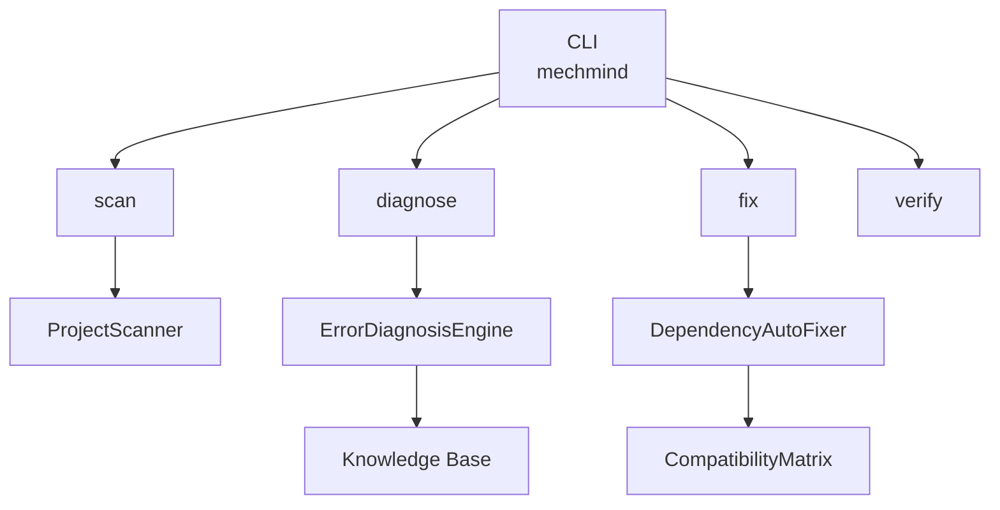

# MechanicalMind Dependency AI v3

**Gestión inteligente de dependencias con análisis multi-ecosystem.**


---

## ✨ Qué hace hoy

Estos comandos están **implementados y testeados**:

- **`mechmind scan`** — escanea un proyecto y detecta dependencias en
  `requirements.txt`, `pyproject.toml`, `package.json`, `pom.xml` y `Dockerfile`.
  Salida en texto o JSON.
- **`mechmind diagnose`** — analiza un log de error y propone soluciones
  basadas en una knowledge base local (JSON + SQLite).
- **`mechmind fix`** — auto-fix de errores de versión. Por defecto **simula**
  (solo recomienda la versión); con `--apply` escribe el cambio en el
  `requirements.txt` indicado.
- **`mechmind verify`** — calcula el checksum (`md5` / `sha1` / `sha256` /
  `sha512`) de cualquier archivo.
- **`mechmind version`** — muestra la versión instalada.

---

## 🚧 Roadmap (aún no implementado)

Los siguientes comandos existen en el CLI pero devuelven un mensaje de
"roadmap". Están reservados para futuras versiones:

- `mechmind monitor` — monitoreo continuo de dependencias.
- `mechmind learn` — entrenamiento de modelos ML con datos de uso.
- `mechmind plugins` — plugins para nuevos ecosistemas (Go, Rust, Ruby…).

> Nota honesta: versiones anteriores de este README prometían features
> que aún no existían (AI resolution engine, CVE shield, Docker image,
> PyPI release, GitHub Action). Esas features siguen en roadmap y se
> irán añadiendo de verdad, empezando por los comandos listados arriba.

---

## ⚙️ Instalación

```bash
git clone https://github.com/MechBot-2x/MechanicalMind-Dependency-AI.git
cd MechanicalMind-Dependency-AI
python -m venv .venv
source .venv/bin/activate     # en Windows: .venv\Scripts\activate
pip install -e .
```

Requisitos: Python 3.11+ (probado en 3.11, 3.12 y 3.14).

---

## 🛠️ Uso
Escanear un proyecto

```bash
mechmind scan --path ./mi-proyecto
mechmind scan --path . --format json | python -m json.tool
```

Ejemplo de salida:

```
🔎 Escaneando: /ruta/al/proyecto

📦 Paquetes detectados: 5
🧩 Ecosistemas: python, node

Paquetes:
   [python] requests >=2.26.0
   [python] pyyaml >=6.0
   [node  ] express ^4.18.0
   ...
```

Diagnosticar un error

```bash
mechmind diagnose "ModuleNotFoundError: No module named 'requests'"
```

Auto-fix de versión

```bash
# Simulación: solo recomienda, no toca el archivo
mechmind fix -p requests -r requirements.txt

# Aplicar de verdad
mechmind fix -p requests -r requirements.txt --apply
```

Verificar checksum

```bash
mechmind verify README.md --algorithm sha256
```

---

## 🧪 Desarrollo
```bash
pip install -e ".[dev]"
bash scripts/lint.sh          # ruff + black + pytest
python -m pytest -v
```

· Lint: ruff check src
· Format: black src
· Tests: pytest — 72 tests hoy
· CI: GitHub Actions en .github/workflows/python_CI.yml

Estructura de src/

```
src/mechanicalmind_ai/
├── __init__.py               # __version__
├── __main__.py               # python -m mechanicalmind_ai
├── cli.py                    # Grupo Click con subcomandos
├── core/
│   ├── __init__.py           # API pública
│   ├── analyzer.py           # DependencyAnalyzer
│   ├── auto_fix_module.py    # DependencyAutoFixer
│   ├── compatibility_matrix.py   # SQLite de compatibilidades
│   ├── error_diagnosis_engine.py # Motor de diagnóstico
│   ├── scanner.py            # ProjectScanner (multi-ecosystem)
│   ├── knowledge_base/       # JSON + SQLite
│   └── utils/                # file / network / logging helpers
└── tests/                    # unittest + pytest
```

---

## 🏗️ Arquitectura


---

## 📦 Dependencias

Instalables con `pip install -e .`:

- `requests>=2.32.4`
- `packaging>=21.0`
- `pyyaml>=6.0`
- `click>=8.0.0`
- `sqlalchemy>=1.4.0`

Opcionales:

- `pip install -e ".[test]"` → pytest, pytest-cov, pytest-timeout
- `pip install -e ".[dev]"` → black, ruff, isort
- `pip install -e ".[docs]"` → sphinx
- `pip install -e ".[ml]"` → numpy, pandas, scikit-learn (roadmap)

---

## 🤝 Contribuir

- [CONTRIBUTING.md](CONTRIBUTING.md) — guía de contribución.
- [CHANGELOG.md](CHANGELOG.md) — historial de cambios.
- [Issues](https://github.com/MechBot-2x/MechanicalMind-Dependency-AI/issues) — reportar bugs o pedir features.

---

## 📜 Licencia

Apache 2.0 — ver [LICENSE](LICENSE).

---

**MechanicalMind AI** © 2025-2026
